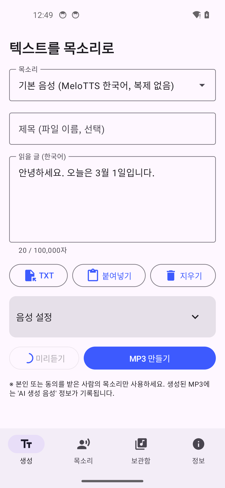

# 한국어 보이스클론 (OpenVoice V2 기반 안드로이드 앱)

음성 샘플 하나로 목소리를 복제해, 한국어 글(최대 100,000자)을 그 목소리로 읽은 **MP3**를 만드는
안드로이드 앱입니다. 유료 API나 서버 없이 **모든 처리를 휴대폰 안에서** 오픈소스 모델로 실행합니다.

> 비공식 프로젝트입니다. MyShell.ai의 OpenVoice / MeloTTS를 MIT 라이선스에 따라 사용합니다.

---

## 1. OpenVoice 조사 결과 (실제로 확인한 내용)

| 항목 | 확인 결과 |
|---|---|
| 설치 방법 (원본) | Python 3.9 + `pip install -e .` + `pip install git+https://github.com/myshell-ai/MeloTTS.git` + `python -m unidic download`. V2 체크포인트는 문서의 S3 링크(`checkpoints_v2_0417.zip`)가 **현재 404**라서 Hugging Face [`myshell-ai/OpenVoiceV2`](https://huggingface.co/myshell-ai/OpenVoiceV2)에서 받아야 함 |
| 구조 | V2 = **MeloTTS(기본 화자 TTS)** → **ToneColorConverter(음색 변환)**. 참조 음성에서 256차원 화자 임베딩(SE)을 뽑아 기본 화자 음성의 음색을 바꿈 |
| 한국어 지원 | V2에서 공식 지원. 실제 한국어 음성은 [`myshell-ai/MeloTTS-Korean`](https://huggingface.co/myshell-ai/MeloTTS-Korean)이 생성하고, 변환기에는 `base_speakers/ses/kr.pth`가 쓰임. MeloTTS 한국어는 g2pkk(+mecab) 발음 변환과 [`kykim/bert-kor-base`](https://huggingface.co/kykim/bert-kor-base) BERT 특징을 사용 |
| 모델 파일 | converter `checkpoint.pth` 131MB, MeloTTS-Korean `checkpoint.pth` 208MB, bert-kor-base 476MB (합계 ~815MB, fp32 PyTorch) |
| 라이선스 | OpenVoice V1/V2, MeloTTS: **MIT** (상업적 사용 가능). bert-kor-base: Apache-2.0이지만 저작자가 **상업적 사용 시 MOU 문의**를 요청함 (아래 7절) |
| 원본 기기 요구 사항 | PyTorch, CUDA GPU 권장(CPU 가능). 모바일 실행 수단은 제공되지 않음 → 이 프로젝트에서 ONNX로 변환 |
| 원본 버그 | `ToneColorConverter(..., enable_watermark=False)`가 `TypeError`를 냄 (kwargs를 부모 클래스로 넘김). 우회해서 사용 |

## 2. 전체 구조

```
[텍스트 ≤100,000자]
   │  KoreanNormalizer: 숫자(세 개/삼 개월/세 시/십삼 시), 날짜·시간·전화번호·단위·통화·분수,
   │                    한자→한글(두음법칙), 영어(외래어 사전 → CMUdict → 철자), 기호/이모지 정리
   ▼
TextChunker: 문장·문단 분할, 긴 문장은 쉼표/연결어미에서 분할, 짧은 문장 병합, 쉼 길이 결정
   ▼  (청크마다, 2단계 파이프라인 — TTS 단계와 변환 단계가 동시에 실행)
MeloFrontend (g2pkk 규칙 Kotlin 이식 + mecab 증류 규칙표 + BERT WordPiece)
   ▼
bert_kr.onnx (BERT 10층) ─► melo_kr.onnx (MeloTTS-KR, 44.1kHz) ─► 리샘플(22.05kHz)
   ▼
tone_convert.onnx (OpenVoice 음색 변환)  ◄── 목소리 프로필(SE, tone_extract.onnx로 추출)
   ▼
청크별 디스크 캐시(중단 후 이어하기) → 무음 정리·음량 평준화·쉼 삽입·리미터 → MP3(LAME/jump3r)
```

| 모듈 | 내용 |
|---|---|
| `core/` | 순수 Kotlin(JVM) 엔진. 데스크톱 JVM에서 실제 모델로 테스트 가능 |
| `app/` | Jetpack Compose UI, 파일 선택(SAF: 내 파일·Google 드라이브·다운로드), 녹음, 포그라운드 서비스, MP3 내보내기/공유 |
| `modelpack/` | 기기용 ONNX 모델 (48MB 이하 조각으로 분할, `manifest.json`에 SHA-256) |
| `tools/` | 모델 변환·압축·평가 스크립트 (재현용) |

### 최소 기능 버전(MVP)에서 출발해 확장한 범위
1. **MVP**: 샘플 파일 1개 → 목소리 임베딩, 한 문장 합성, WAV 저장 → 검증 후
2. **완성판(현재)**: 다중 샘플/녹음, 100,000자 장문 분할·병렬 파이프라인·이어하기, MP3, 백그라운드 서비스, 미리듣기, 보관함

## 3. 성능·품질을 끌어올린 방법 (모두 실측)

| 아이디어 | 결과 |
|---|---|
| **모듈별 혼합 정밀도 압축**: 민감도 분석으로 디코더/플로우만 int8, 텍스트 인코더·posterior encoder는 fp16, STFT 기저는 fp32. BERT는 8bit 블록 양자화 + **int8 임베딩 Gather 재작성**(전체 테이블 역양자화 없이 필요한 행만) | 724MB → **212MB**. Whisper CER 1.88% → 2.14% (차이 미미). BERT 실행 메모리 증가분 +590MB → +130MB |
| BERT 운율 특징 유지 (0으로 대체하지 않음) | BERT를 빼면 CER이 1.9% → 3.5%로 나빠져서 유지 |
| BERT는 필요한 층만 (hidden_states[-3] = 10층) | 12층 → 10층 (마지막 2층 + MLM 헤드 제거) |
| **mecab 증류**: g2pkk가 mecab에 의존하는 유일한 부분(용언 어간 `/P` 태그 → 경음화: 읽고[일꼬], 신고[신꼬])을 위키백과 190만 단어에 대한 mecab 판단에서 14KB 규칙표로 증류 | 원본(mecab) 프런트엔드와 **3,020문장 중 3,018문장 완전 일치** (불일치 2건은 mecab이 비표준 발음을 낸 경우) |
| **문장별 원본 화자 임베딩 + 음색 강조(α=1.2)**: OpenVoice의 고정 kr.pth 대신 생성된 문장 자체의 임베딩을 원본으로 사용 | 화자 유사도(코사인) 3명 평균 **0.815 → 0.85**, CER 변화 없음 |
| **리샘플러 튜닝**: 화자 인코더가 8–11kHz 대역에 민감함을 발견 (8kHz 저역통과 시 유사도 0.78) | 64 zero-crossing Kaiser 필터로 librosa/soxr와 임베딩 코사인 **0.998** (24탭은 0.958) |
| **2단계 파이프라인**: BERT+MeloTTS(청크 i+1)와 음색 변환(청크 i)을 다른 스레드에서 동시 실행 | 4코어 서버: 순차 RTF 0.545 → **0.520**. 4+4 과할당은 0.669로 오히려 느려서, 코어의 절반씩 할당 |
| 한국어 정규화 강화 | 원본 g2pkk는 "2024"를 "이영이사"로 읽고, 기호가 오면 KeyError로 중단됨 → 해결 |

### 정확도 검증 (Kotlin 엔진 = Python 원본)
- 프런트엔드: Python(g2pkk+동일 규칙표)과 **3,020/3,020 문장 비트 단위 일치**, 문장당 0.7–1.9ms
- 음성: 같은 입력에서 Kotlin과 Python의 MeloTTS 출력 SNR **232dB** (사실상 동일)
- Kotlin 출력 20문장 Whisper(large-v3-turbo) **CER 2.46%** (오류 대부분은 Whisper가 "10월"처럼 숫자로 받아쓴 것)
- 장문: 1,163자 → 43청크 → 172초 MP3, 처리 103초 (4코어 서버, RTF 0.60)

## 4. 기기 요구 사항 / 예상 속도
- **Android 8.0(API 26) 이상, 64비트 ARM(arm64-v8a), RAM 4GB 이상 권장** (모델 상주 메모리 약 0.6–0.8GB)
- 저장 공간: full APK 228MB + 압축 해제된 모델 212MB (약 450MB)
- 속도: 4코어 x86 서버 실측 RTF ≈ 0.5–0.6 (1분짜리 음성 ≈ 30–36초). **실제 휴대폰에서는 측정하지 못했습니다.**
  최신 플래그십은 비슷하거나 1.5배, 보급형은 2–4배 느릴 것으로 예상합니다.
  한국어 낭독은 초당 약 7자이므로 100,000자 ≈ 약 4시간 분량의 음성이고, 휴대폰에서는 수 시간이 걸립니다
  (화면을 꺼도 계속되며 중단 후 이어서 생성 가능).

## 5. 설치 및 사용
1. `KoreanVoice-full.apk` 설치 (알 수 없는 앱 설치 허용 필요). 처음 실행 시 모델을 내부 저장소로 복사(수십 초).
   - `KoreanVoice-lite.apk`(15MB)는 첫 실행 때 이 저장소의 `android/modelpack`에서 모델(212MB)을 내려받습니다.
     **이 브랜치가 GitHub에 푸시되어 있어야 동작합니다.**
2. **목소리** 탭 → 목소리 추가 → 동의 체크 → *파일 선택*(내 파일, Google 드라이브, 다운로드 등. mp3/m4a/wav/flac/ogg) 또는 *녹음*
   → 품질 점수 확인 → 저장. 10–30초의 깨끗한 음성이 좋고, 여러 파일을 넣으면 평균을 냅니다.
3. **생성** 탭 → 목소리 선택 → 글 입력/붙여넣기/TXT 불러오기 (UTF-8, UTF-16, EUC-KR 자동 인식) → *미리듣기* → *MP3 만들기*.
4. 완료된 MP3는 앱 보관함과 `음악/KoreanVoice` 폴더에 저장되고, *저장* 버튼으로 Google 드라이브 등에 내보낼 수 있습니다.

## 6. 빌드 방법
```bash
cd android
# 코어 테스트 (프런트엔드 골든 테스트 + 정규화 테스트)
./gradlew :core:test
# 실제 모델로 엔드투엔드 테스트 (모델 디렉터리는 modelpack 조각을 합친 폴더)
./gradlew :core:test -DmodelDir=/path/to/models -DgoldenDir=/path/to/golden -DoutDir=/tmp/out
# APK (full: modelpack을 자산으로 포함 / lite: 첫 실행 시 다운로드)
./gradlew :app:assembleFullRelease :app:assembleLiteRelease -PmodelBaseUrls="https://raw.githubusercontent.com/<owner>/<repo>/<ref>/android/modelpack"
```
서명: `android/release.keystore`가 있으면 그것으로, 없으면 디버그 키로 서명합니다 (키스토어는 저장소에 올리지 않음).

모델 재생성 (Python 3.11, torch CPU):
```bash
python tools/export_onnx.py        # PyTorch → ONNX (fp32), validate_onnx.py로 원본과 비교
python tools/build_modelpack.py    # 혼합 정밀도 압축 → modelpack
python tools/distill_p.py          # mecab-ko 판단 → p_table.tsv (python-mecab-ko 필요)
python tools/make_golden.py mecab 3000   # 프런트엔드 골든 데이터
```

## 7. 라이선스
- 이 앱의 코드: MIT. 포함된 구성요소의 고지는 `app/src/main/assets/THIRD_PARTY_NOTICES.txt`.
- OpenVoice V2, MeloTTS-Korean: MIT. g2pkk: Apache-2.0. CMUdict: BSD. Unihan: Unicode License. ONNX Runtime: MIT.
- jump3r(LAME 자바 이식): LGPL-2.1+, 수정 없이 라이브러리로 사용하고 앱 전체 소스를 공개하여 교체 가능.
- **kykim/bert-kor-base**: Apache-2.0으로 배포되지만 저작자가 "모델의 상업적 사용은 MOU를 통해 무료로 가능하니
  kykim@artificial.sc로 문의"하라고 안내합니다. **개인·비상업적 사용은 문제없지만, 상업적으로 배포하려면 먼저 문의하세요.**
- 음성 복제는 본인 또는 동의받은 사람의 목소리에만 사용하세요. 생성 MP3에는 ID3 태그로 'AI 생성 음성'이 기록됩니다.

## 8. 안드로이드 테스트 기록 (정직한 현황)
테스트 서버에는 하드웨어 가속(KVM)이 없어 Android 14 에뮬레이터를 **소프트웨어 에뮬레이션**으로 실행했습니다 (부팅 13–23분).

| 단계 | 결과 |
|---|---|
| APK 설치 (lite debug, x86_64) | ✅ 성공 (full APK 260MB는 설치 중 에뮬레이터 시스템 워치독이 system_server를 재시작시켜 실패 → 모델을 직접 복사) |
| 앱 실행 · 모델 확인 화면 → 메인 화면 | ✅ 정상 (아래 스크린샷) |
| 한국어 UI, 텍스트 주입 | ✅ 정상 |
| ONNX Runtime 세션 4개(BERT·MeloTTS·추출기·변환기) 로드 | ✅ 안드로이드에서 로드 완료 |
| 미리듣기 합성 | ❌ → 🔧 **안드로이드 전용 버그 발견**: 안드로이드 정규식(ICU)은 `Pattern.UNICODE_CHARACTER_CLASS`를 지원하지 않음. `[^\p{L}\p{N}_]`로 바꿔 수정하고, JVM 골든 테스트로 결과가 동일함(3,020/3,020)을 확인. 수정 후 에뮬레이터 재검증은 에뮬레이터가 부팅 중에도 워치독 재시작을 반복해 완료하지 못함 |



엔진 로직(텍스트 처리 → BERT → MeloTTS → 음색 변환 → MP3)은 안드로이드와 같은 ONNX Runtime 1.31 API로 JVM에서 실제 모델을
돌려 검증했습니다 (3절). **실제 휴대폰에서의 합성 속도와 동작은 아직 확인되지 않았으니, 설치 후 문제가 있으면 오류 메시지를 알려 주세요.**

## 9. 알려진 한계
- 여러 사람의 목소리가 섞이거나 배경 음악이 큰 샘플은 결과가 나빠집니다.
- OpenVoice 특성상 억양·말투보다 **음색** 복제에 강하고, 말투는 MeloTTS 한국어 기본 화자를 따릅니다.
